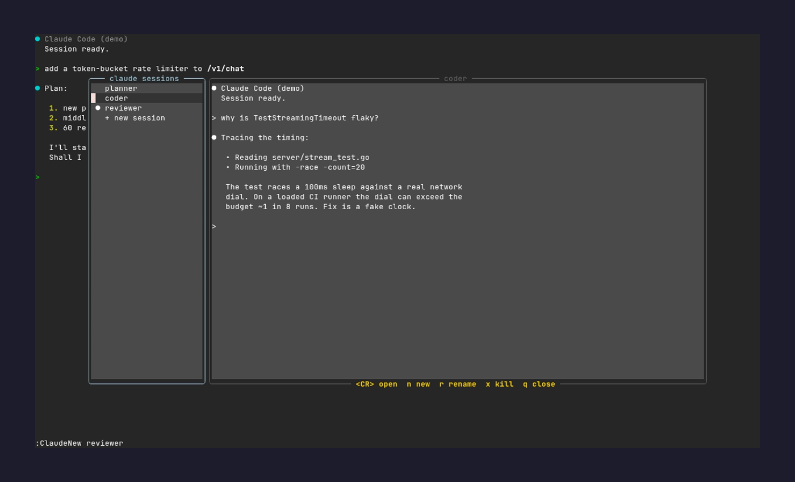
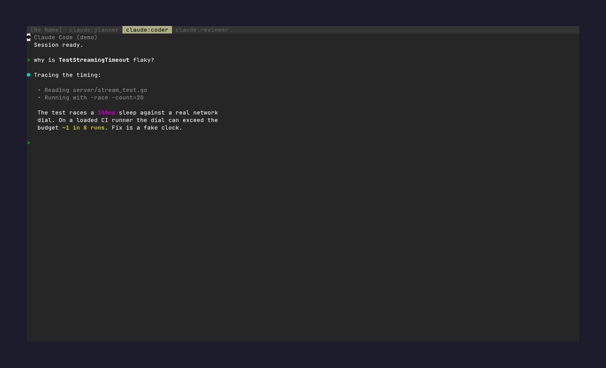
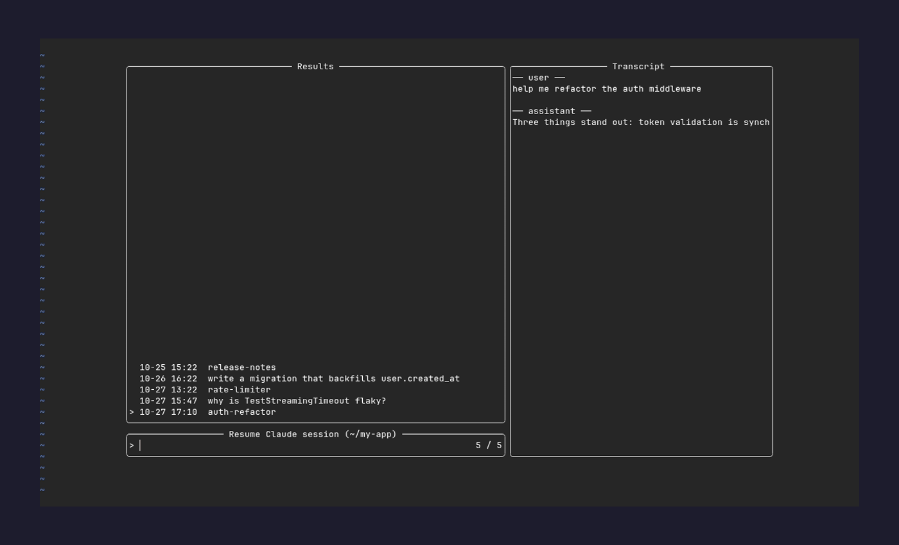

# claude-orchestra.nvim

Orchestrate multiple Claude Code CLI sessions inside Neovim. Each session lives in its own terminal buffer (or its own tab), switchable through a session list with live preview, with resumption of past sessions.

Requires Neovim 0.10+, the `claude` CLI on `$PATH`, and (optionally) [telescope.nvim](https://github.com/nvim-telescope/telescope.nvim) for the resume-history picker.

## Install

With [lazy.nvim](https://github.com/folke/lazy.nvim):

```lua
{
  "memy85/claude-orchestra.nvim",
  config = function() require("claude-orchestra").setup({}) end,
}
```

With [packer.nvim](https://github.com/wbthomason/packer.nvim):

```lua
use {
  "memy85/claude-orchestra.nvim",
  config = function() require("claude-orchestra").setup({}) end,
}
```

To pin a release, add `tag = "v0.4.0"` (packer) or `version = "v0.4.0"` (lazy.nvim). See [Releases](https://github.com/memy85/claude-orchestra.nvim/releases) for the changelog.

## Commands

| Command | Description |
|---------|-------------|
| `:ClaudeNew [name]` | Spawn a new `claude` session in the current window. Optionally name it. |
| `:ClaudeList` | Open the session list with a live preview of the highlighted session. |
| `:ClaudeSwitch [name]` | Switch to a session by name. Without a name, opens the list. |
| `:ClaudeNext` / `:ClaudePrev` | Cycle to the next/previous session in creation order. |
| `:ClaudeRename [name]` | Rename the active session. Prompts if no argument. |
| `:ClaudeKill [name]` | Kill a session by name. Without a name, kills the session of the current buffer (no-op if not in a claude buffer). |
| `:ClaudeResume [id]` | Resume a past session for the current cwd. Opens the history picker if no argument. |
| `:ClaudeResume!` | Resume picker across **all** past projects (shows cwd column). |

## Default keymaps

All under the `<leader>c` prefix (mnemonic: **C**laude).

| Keys | Action |
|------|--------|
| `<leader>cn` | new session |
| `<leader>cl` | open the session list (switch / spawn / kill / rename from there) |
| `<leader>c]` / `<leader>c[` | next / previous session |
| `<leader>cr` | rename active session |
| `<leader>ck` | kill the current claude session (or use `x`/`dd` inside the list) |
| `<leader>ch` | resume past session (history picker) |

### Inside the list



| Keys | Action |
|------|--------|
| `j`/`k` or arrows | move between sessions; the right pane previews the highlighted one |
| `<CR>` or `l` | switch to the highlighted session (or spawn one on `+ new session`) |
| `n` | spawn a new session |
| `x` or `dd` | kill the highlighted session, list refreshes |
| `r` | rename the highlighted session |
| `q` or `<Esc>` | dismiss the list |

## Terminal-mode tip

Inside a Claude session you're in terminal-insert mode and most keymaps are swallowed. Press `<C-\><C-n>` to drop into terminal-normal mode, then the `<leader>c*` keymaps (and ordinary window commands like `:vsplit`, `:Ex`) work.

## Configuration

`setup({})` defaults — override any subset:

```lua
require("claude-orchestra").setup({
  cmd = { "claude" },              -- command used to launch a session
  auto_insert = true,               -- enter terminal-insert mode after spawn/show
  open_in = "buffer",               -- "buffer" (current window) or "tab" (one tabpage per session)
  keymaps = {
    prefix = "<leader>c",
    new = "n",
    switch = "l",
    kill = "k",
    rename = "r",
    next = "]",
    prev = "[",
    resume = "h",
    tab_next = "<C-Tab>",           -- tab mode only, not prefixed
    tab_prev = "<C-S-Tab>",
  },
})
```

Set any keymap field to `false` (or `""`) to disable just that binding.

## Tab mode

With `open_in = "tab"`, each session gets its own tabpage:



- The tabline labels session tabs `claude:<name>`; other tabs show their file name.
- `<C-Tab>` / `<C-S-Tab>` cycle through all tabs, and also work from inside a session's terminal.
- Killing a session closes its tab; switching to a session jumps to its existing tab.

## Session names follow `/rename`

Each session is launched with a pinned `--session-id` and a `SessionStart` hook passed via `--settings` (your own settings files are untouched). The hook reports which conversation is live, so after `/rename`, `/resume`, or `/clear` inside Claude, the plugin reads the current transcript and renames the session — and its tab — to the conversation's title within about two seconds.

## Resume



`:ClaudeResume` (or `<leader>ch`) reads `~/.claude/projects/<encoded-cwd>/*.jsonl` — the on-disk transcripts maintained by the `claude` CLI — and shows them in a telescope picker sorted newest-first. Sessions renamed with `/rename` are listed under their title; others show their first message. Selecting one spawns `claude --resume <session-id>` in the current window.

By default, only sessions whose recorded `cwd` matches Neovim's current working directory are listed (mirroring `claude --resume` behavior). Use `:ClaudeResume!` to browse sessions from every project — useful when you started a session from a terminal in a different directory.

## Status

Working: spawn, switch, cycle, session list with live preview, tab mode, inline rename (synced with `/rename`), kill, resume from on-disk history (with telescope picker). Not yet: persistent named sessions across nvim restarts, cross-session merge, custom telescope themes.

Issues and PRs welcome.

## License

MIT — see [LICENSE](LICENSE).
